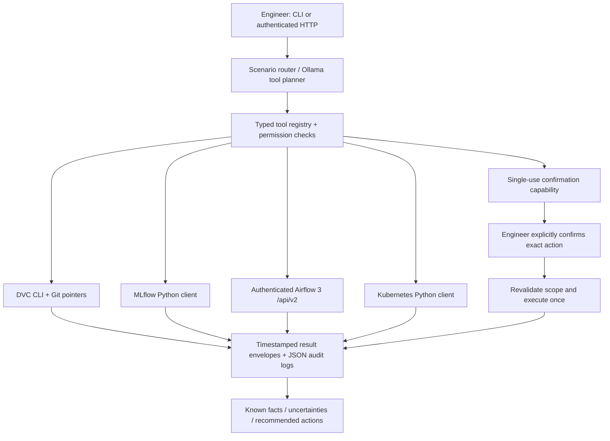

# Architecture and engineering decisions

The default router runs five reproducible demonstration scenarios without an LLM. Set
`AGENT_PLANNER=ollama` to enable real model-selected structured tool calls through Ollama's
`/api/chat`. It supports six rounds and four calls per round. The mandatory integration
scenario always uses the explicit evidence-collection workflow so all four integrations are
checked and retraining is never triggered. The LLM's prose is excluded from the final
operational report: facts are rendered from tool results with evidence IDs.

## Data and model lifecycle

```mermaid
flowchart LR
  Iris[Built-in sklearn Iris dataset] --> DVC[CSV + committed .dvc pointer + remote]
  DVC --> V[Validation]
  V --> P[Deterministic stratified split]
  P --> T[Scaler + LogisticRegression]
  T --> E[Macro F1 + accuracy + MLflow artifacts]
  E --> G[Quality gate F1 >= 0.85]
  G --> A[Approved artifact / manual export]
  A --> Image[Versioned inference image]
  Image --> Deploy[Manual Kubernetes rollout: 2 replicas]
```

Airflow's TaskFlow DAG defines these dependencies with default `all_success` behavior,
two retries, ten-second retry delays, isolated per-run artifacts, and one active DAG run.
Validation failure prevents training. Failed quality evaluations retain diagnostic metrics
but do not register a candidate model or create an approval artifact. No task deploys.
The DVC training stage offers the same reproducible workflow outside Airflow.

Each MLflow run records `dataset.git_commit`, `dataset.dvc_digest`, `dataset.path`, and
`dataset.sha256`. Evaluation verifies actual CSV bytes against the `.dvc` pointer at that
commit. The agent resolves that historical Git pointer instead of assuming today's data
trained a historical run. Version comparisons use DVC; reproduction uses a new clone and
the configured remote. Source data is never checked out over the active workspace.

Inference verifies the serialized model's SHA-256 and quality metadata before loading.
`/health/live` measures process health; `/health/ready` returns 503 until the model is usable.
`/metadata` reports the loaded run ID. Deployment annotations identify a declared model;
they do not prove which bytes a running process loaded. Check `/metadata` to close that gap.

## Tool contracts and permissions

Every tool uses a Pydantic model with extra arguments forbidden. Results contain tool,
status, data/error, duration, request ID, and UTC observation time. Unsupported tools,
invalid arguments, unavailable services, timeouts and denied operations remain distinct
from successful results. Audit logs include only tool name, status, duration and request ID.
Raw exceptions, credentials and request bodies are excluded. Pod/task logs redact common
secret forms, are bounded, and are treated as untrusted evidence.

| Module | Callable tools | Permission |
|---|---|---|
| DVC | `dvc_list`, `dvc_version`, `dvc_status`, `dvc_diff`, `dvc_reproduce` | Read-only approved CLI/Git operations; no shell interpolation |
| MLflow | `mlflow_experiments`, `mlflow_runs`, `mlflow_best`, `mlflow_run`, `mlflow_compare`, `mlflow_versions` | Read-only client APIs |
| Airflow | `airflow_dags`, `airflow_runs`, `airflow_tasks`, `airflow_logs` | JWT-authenticated reads |
| Airflow | `airflow_trigger` | Allowlisted training DAG; explicit confirmation |
| Kubernetes | `kubernetes_pods`, `kubernetes_deployments`, `kubernetes_services`, `kubernetes_events`, `kubernetes_logs` | Approved namespace; application label scope for Pods/Deployments/Services/logs |
| Kubernetes | `kubernetes_restart` | Approved deployment in approved namespace; explicit confirmation |

Confirmation is enforced outside the model. A write proposal creates a random server-owned
capability bound to normalized tool arguments, expiring after 120 seconds. An authenticated
human must submit it to `/confirm` or type `confirm TOKEN` in the same interactive CLI
session. Consumption is atomic, single-use, and followed by scope validation. Merely adding
`confirmed=true` or `approved=true` to tool arguments fails validation. Namespace-scoped
RBAC adds a second enforcement layer. The inference Pod has no service account token.

## Correlation and recommendations

Candidate selection ranks the most recent five runs in the configured experiment, filters
to finished runs with finite metrics, supports maximization/minimization, and explains the
scope. A metric winner can still fail a quality gate. The report compares recorded dataset
provenance, replica health, declared deployed run identity, and recent workflow status.
Failures produce explicit uncertainty rather than invented metrics or a healthy status.
Retraining review requires a recorded failed gate or the configured training freshness
policy (`FRESHNESS_DAYS`, default 30). Pod failures and changed files alone are insufficient.

## Limits

This is an educational deployment with production-oriented controls, not a highly available
control plane. Confirmation state lives in one process; use one agent worker. HTTP access
uses one environment-provided bearer credential. Logs may contain unusual secret formats
that regex redaction cannot recognize; review exports before publication. Tool request
timeouts bound individual network calls, not a global transaction; MLflow artifact downloads
may take longer. API pages and diagnostic fan-out are bounded, not exhaustive. Training retries
can create duplicate MLflow runs. Pickle/joblib artifacts must come from a trusted tracking
server. Drift detection, identity federation, distributed audit storage, remote object storage,
image signing, immutable image digests, admission policies and production Airflow topology are
future improvements. The provided Compose stack is for local demonstration only.

## Primary references

- [Airflow 3 public API and JWT authentication](https://airflow.apache.org/docs/apache-airflow/stable/security/api.html)
- [Airflow 3.1.0 Docker deployment guide](https://airflow.apache.org/docs/apache-airflow/3.1.0/howto/docker-compose/)
- [MLflow Python client](https://mlflow.org/docs/latest/api_reference/python_api/mlflow.client.html)
- [DVC diff command](https://doc.dvc.org/command-reference/diff)
- [Ollama structured tool calling](https://github.com/ollama/ollama/blob/main/docs/capabilities/tool-calling.mdx)
